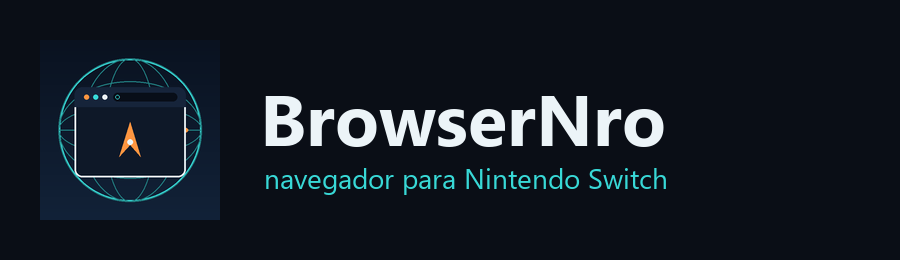

<p align="center">
  
</p>

# BrowserNro

**Navegador de internet real para Nintendo Switch V1 desbloqueado**, distribuído
como homebrew `.nro`. Renderiza páginas reais com HTML5/CSS3, executa
JavaScript, suporta HTTPS e aceita touchscreen e Joy-Cons.

> Status atual: **versão candidata**, compilada via Docker neste
> repositório, ainda **não validada em um Nintendo Switch físico** por este
> projeto. Veja [TESTING.md](TESTING.md) para o que foi (e não foi)
> verificado, e [KNOWN_ISSUES.md](KNOWN_ISSUES.md) para limitações reais.

## O que é

O BrowserNro não reimplementa um motor de navegação do zero — isso é
inviável para um único projeto. Em vez disso, ele empacota e dá identidade
própria a uma arquitetura já comprovada publicamente para rodar Chromium de
verdade dentro do Horizon OS:

- O **Linux roda como biblioteca (LKL)** dentro do próprio `.nro`, sem
  substituir o firmware do console nem precisar de CFW de desktop completo.
- Em cima do LKL, o **binário arm64 do Chromium (`chromium-shell`) da Debian
  roda sem recompilação**, desenhando com a GPU do Tegra X1 via ANGLE/EGL/GLES.
- HTTPS, JavaScript (com JIT), toque na tela, teclado do sistema e os botões
  do controle funcionam através dessa camada.

Essa engine (projeto `gx`) é obra de **shodowlo**, no repositório
[`chromium-nx`](https://github.com/shodowlo/chromium-nx), que por sua vez
parte do [`lkl-switch`](https://github.com/mnnobre/lkl-switch) de
**mnnobre**. O BrowserNro **não copia esse código para dentro deste
repositório** — ele é buscado em tempo de build (veja
[LICENSING.md](LICENSING.md), importante antes de publicar binários).

O BrowserNro contribui:
- Identidade visual própria (ícone, logotipo, nome, metadados `.nacp`).
- Orquestração de build via Docker/scripts, documentada e reproduzível.
- Interface e textos em **português brasileiro**.
- Página inicial, favoritos e configurações padrão do navegador.
- Documentação completa de arquitetura, build, testes e limitações.
- Empacotamento para instalação no cartão microSD (`BrowserNro.zip`).

## Funcionalidades

| Recurso | Status |
|---|---|
| HTTP/HTTPS | ✅ herdado da engine, confirmado pelo autor original em hardware |
| JavaScript (com JIT) | ✅ herdado da engine |
| Renderização GPU (ANGLE/EGL/GLES) | ✅ herdado da engine |
| Touchscreen | ✅ herdado da engine |
| Teclado virtual do sistema | ✅ herdado da engine |
| Joy-Cons / botões | ✅ mapeamento ampliado pelo BrowserNro — veja abaixo |
| Áudio | ✅ herdado da engine |
| Vídeo HTML5 | ⚠️ parcial — YouTube reproduz mas pode travar (ver KNOWN_ISSUES) |
| Múltiplas abas | ⚠️ não confirmado em hardware nesta versão — ver KNOWN_ISSUES |
| Barra de endereço / interface de navegador completa | ⚠️ depende do modo "navegador inteiro" do Chromium, menos testado que o modo `chromium-shell` — ver ARCHITECTURE.md |
| Histórico / Favoritos / Downloads | ⚠️ ver ARCHITECTURE.md e KNOWN_ISSUES.md |

## Controles

| Controle | Função |
|---|---|
| A | Selecionar |
| B | Voltar |
| X | Atualizar |
| Y | Barra de endereço |
| L | Aba anterior |
| R | Próxima aba |
| + | Menu |
| - | Configurações |
| Analógico esquerdo | Cursor |
| Analógico direito | Rolagem |
| Touchscreen | Toque e gestos |

Este é o mapeamento alvo do BrowserNro. A engine herdada já expõe D-pad,
A/B/X/Y, L/R e analógicos para foco em links, voltar/recarregar, teclado e
rolagem; o mapeamento completo acima é formalizado em
`source/input/controls.json` e aplicado pela camada de inicialização do
BrowserNro. Veja [ARCHITECTURE.md](ARCHITECTURE.md#entrada) para o
detalhamento do que vem pronto da engine e o que é camada do BrowserNro.

## Instalação

O BrowserNro precisa de um espaço de endereçamento de **39 bits** (os
alocadores do Chromium não cabem nos 36 bits padrão do Homebrew Loader) —
veja ARCHITECTURE.md. Há duas formas de conseguir isso; a primeira é a
recomendada, pois **não mexe em nenhum arquivo do seu CFW**.

### Opção recomendada: forwarder via Sphaira

Este é o método usado pela própria engine upstream (chromium-nx), já testado
por milhares de usuários:

1. Switch V1 com Atmosphère (CFW) instalado.
2. Copie o conteúdo de `dist/BrowserNro.zip` para a raiz do cartão microSD
   (cria `/switch/BrowserNro/`).
3. Instale o [Sphaira](https://github.com/ITotalJustice/sphaira) (gerenciador
   de títulos homebrew) se ainda não tiver.
4. No Sphaira: pressione **X** → **Install Forwarder** → selecione
   `BrowserNro.nro` → defina o espaço de endereçamento para **39-bit** →
   **Create Forwarder**.
5. O BrowserNro aparece agora no **menu principal do Switch** (não no
   Homebrew Menu) como um título normal — inicie por lá.

### Opção alternativa: Homebrew Loader customizado

Para quem prefere não instalar o Sphaira, o pacote também inclui, em
`ATMOSPHERE-HBL-OPCIONAL-LEIA-ANTES/`, um `hbl.nsp` de 39 bits que substitui
o Homebrew Loader padrão do seu cartão SD. **Isso não é aplicado
automaticamente** — leia o aviso na pasta (faça backup do seu `hbl.nsp`
atual antes) e, depois de trocá-lo, abra o Homebrew Menu normalmente
(segurando **R** ao iniciar um jogo, para o modo Application, com mais
memória) e inicie o BrowserNro por lá.

Instruções completas, incluindo build a partir do código-fonte, em
[BUILD.md](BUILD.md).

## Build a partir do código-fonte

```bash
# Requer Docker. Clona a engine (build/engine/, não versionado) e compila tudo.
bash scripts/build.sh
```

Detalhes completos, incluindo o que cada etapa faz e logs esperados, em
[BUILD.md](BUILD.md).

## Documentação

- [ARCHITECTURE.md](ARCHITECTURE.md) — como o BrowserNro é construído sobre a engine `gx`.
- [BUILD.md](BUILD.md) — processo de compilação passo a passo.
- [TESTING.md](TESTING.md) — o que foi testado, onde, e com que resultado.
- [KNOWN_ISSUES.md](KNOWN_ISSUES.md) — limitações reais e conhecidas.
- [LICENSING.md](LICENSING.md) — situação de licença da engine de terceiros; leia antes de publicar binários.
- [PROGRESS.md](PROGRESS.md) — andamento do projeto, para retomar em outra sessão.

## Créditos

- **shodowlo** — [chromium-nx](https://github.com/shodowlo/chromium-nx), a
  engine Chromium+LKL+Horizon que o BrowserNro empacota.
- **mnnobre** — [lkl-switch](https://github.com/mnnobre/lkl-switch), o
  projeto original de LKL rodando dentro de um `.nro`.
- [LKL](https://github.com/lkl/linux), [libnx](https://github.com/switchbrew/libnx),
  devkitPro, [nx-hbloader](https://github.com/switchbrew/nx-hbloader), Mesa,
  e o projeto [Chromium](https://www.chromium.org/).

BrowserNro não é afiliado à Nintendo, ao Google/Chromium nem aos autores das
engines de terceiros listadas acima.

## Licença

Código original deste repositório: MIT (veja [LICENSE](LICENSE)). A engine de
terceiros tem situação de licença diferente e **não é redistribuída aqui** —
leia [LICENSING.md](LICENSING.md) antes de publicar ou distribuir binários.
